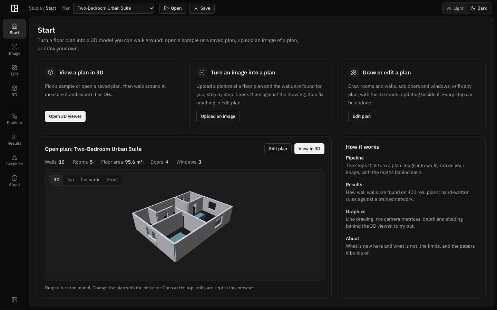
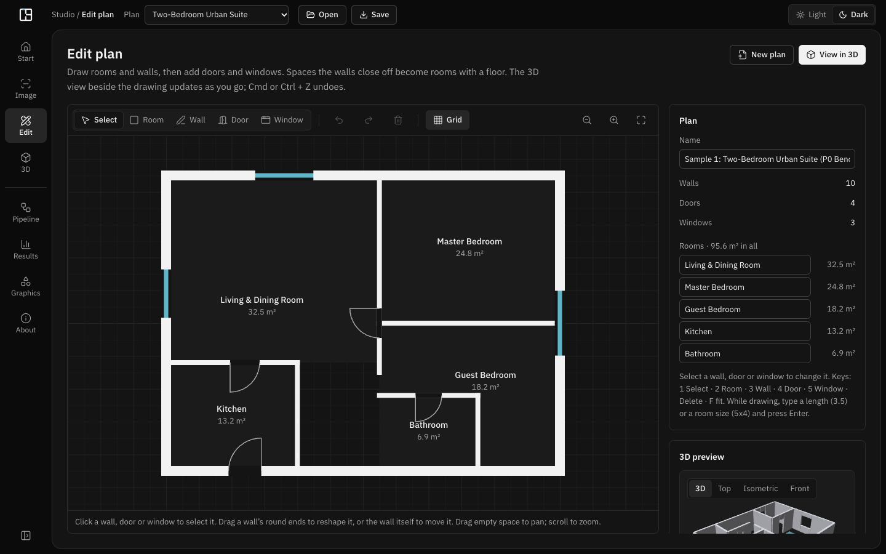
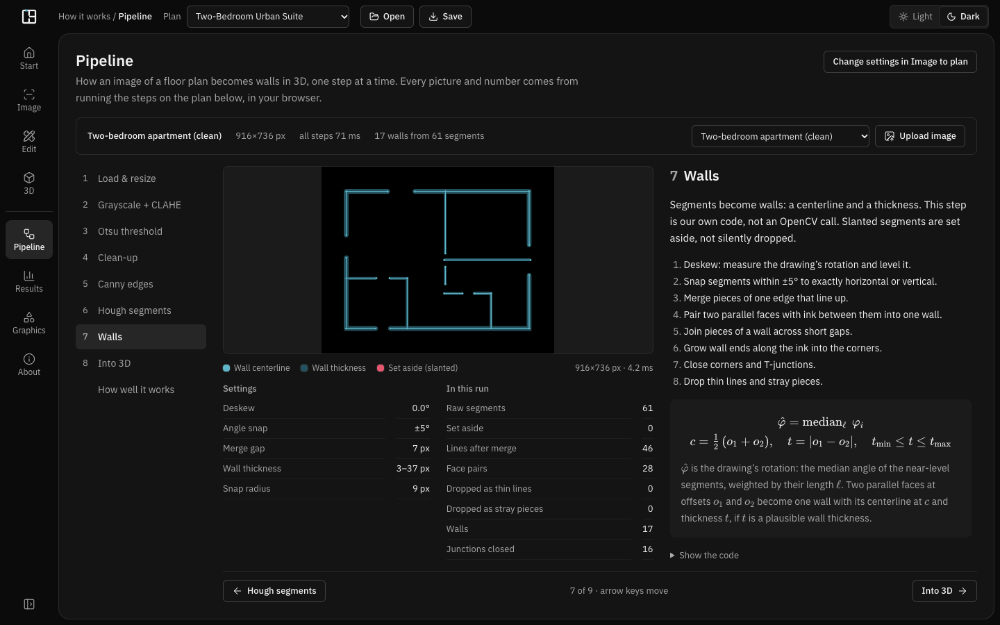
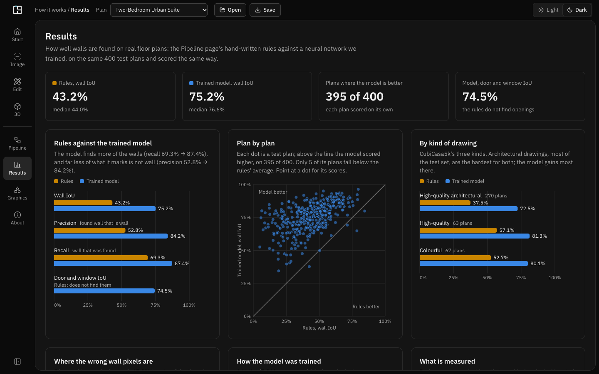

# FloorPlan3D

**From floor plan to 3D, in your browser.**

FloorPlan3D turns a floor plan into a 3D model you can walk around. Start from a sample, upload an image of a plan, or draw your own; fix the walls, doors and windows with every step undoable; then view, measure and export the model. Everything runs on your computer: your images and plans are never sent anywhere.



## What you can do

**Studio**, where a plan is made and viewed:

| Page | What it does |
|---|---|
| **Start** | The three ways in, and the open plan as a live 3D model you can turn. |
| **Image to plan** | Upload a picture of a floor plan; its walls are found step by step with OpenCV.js, then open in 3D or in Edit plan. |
| **Edit plan** | Draw rooms (drag a rectangle) and walls (click corner to corner), type exact sizes (`5x4`, `3.5`), add doors and windows, undo anything. Spaces the walls close off become rooms with a floor and an area. |
| **3D viewer** | Orbit, preset views, measuring, and OBJ export. |

**How it works**, for the curious and for examiners:

| Page | What it shows |
|---|---|
| **Pipeline** | The seven image steps on a real run, one step at a time: the picture after each step, its formula, its settings and its numbers. |
| **Results** | How well walls are found on 400 real plans: hand-written rules against a trained neural network, scored the same way. |
| **Graphics** | Line drawing, the camera matrices, depth precision and shading behind the 3D viewer, to try out. |
| **About** | What is new here and what is not, the limits, the licences and the papers it builds on. |

| Edit plan | Pipeline |
|---|---|
|  |  |



## How well it finds walls

Measured on the 400 test plans of [CubiCasa5k](https://zenodo.org/records/2613548), against walls traced by hand, pixel by pixel (IoU: 100% only when every wall pixel is found and nothing else is):

| | Hand-written rules | Trained model (U-Net) |
|---|---|---|
| Wall IoU, mean | 43.2% | **75.2%** |
| Wall IoU, median | 44.0% | 76.6% |
| Precision / recall | 52.8% / 69.3% | 84.2% / 87.4% |
| Door and window IoU | not found | 74.5% |
| Plans where it does better | | 395 of 400 |

Image to plan uses the rules today; running the trained model in the browser is the next step (the ONNX export is ready and checked).

> **Not 100% accurate.** FloorPlan3D is a student project, offered as it is and without any warranty. Detected walls can be missing, misplaced or extra, and the size of an uploaded plan is a guess. We have tried our best to make it good, and every result can be checked and fixed in Edit plan. Compare a model with the real plan before relying on its walls or measurements; you use it at your own risk.

## Getting started

You need [Node.js](https://nodejs.org) 20.19+ or 22.12+ and npm.

```bash
npm install
npm run dev
```

Then open <http://localhost:3000>. To check and build:

```bash
npm run lint      # type-check
npm test          # unit tests (geometry, plan files, editing, rooms, image pipeline, scoring, formulas)
npm run build     # production build in dist/
npm run preview   # serve the build
```

## Drawing a plan

1. **Edit plan → New plan → Draw a room.** Drag a rectangle; for an exact size, click one corner, point the way the room should grow, type `5x4` and press Enter.
2. **Next rooms:** start each on a corner or wall of the first, so they share that wall.
3. **Split a room** with the Wall tool: click on a wall, point across, type `3.5`, press Enter, then Esc. Each part becomes its own room.
4. **Doors and windows:** click on a wall with the Door or Window tool; drag them along the wall, or type their size in the side panel.
5. **Name rooms** in the side panel, then **Save** to keep the plan as a file.

| Key | Action |
|---|---|
| `1` `2` `3` `4` `5` | Select, Room, Wall, Door, Window |
| `3.5` `5x4` then Enter | Exact wall length or room size while drawing |
| Esc | Stop drawing, then back to Select |
| Delete | Delete the selection |
| Cmd/Ctrl + Z, Shift + Cmd/Ctrl + Z | Undo, redo |
| F, + / −, scroll | Fit, zoom |
| Shift while drawing | Keep a wall straight |

## How it is built

```
image ──► 1 load & resize ─► 2 grayscale + CLAHE ─► 3 Otsu threshold ─► 4 clean-up
      ──► 5 Canny edges ─► 6 Hough segments ─► 7 walls (our own vectoriser)
      ──► plan (JSON) ◄─► Edit plan ──► 3D (walls extruded with door and window holes, WebGL)
```

- **Web app:** React 19, TypeScript, Vite, Tailwind CSS; OpenCV.js (WebAssembly) for the image steps; a hand-written WebGL renderer; KaTeX for the formulas.
- **Plan file:** one versioned JSON format for every source (samples, saved files, detected plans, drawings):
  `{ "format": "floorplan3d-plan", "version": 1, "savedAt": "…", "plan": { walls, openings, rooms, … } }`.
  Older files are converted; newer versions are refused rather than half-read.
- **Wall model:** a U-Net (7.8 M parameters) that labels every pixel as background, wall, door or window, trained with cross-entropy plus soft Dice.

```
src/
  components/   pages (Start, ImagePipelineLab, PlanEditor, OpenGLCanvas, PipelinePage, ResultsPage, …)
  vision/       the image pipeline (OpenCV.js), the wall vectoriser, scoring
  utils/        geometry and 3D meshes, plan editing, rooms from walls, openings
  data/         samples, the plan file format, undo history, results and formulas shown in the app
scripts/        test-plan generator, CubiCasa5k scorer, results export
training/       the wall model: notebook, modules, tests, Kaggle builder, ONNX check
public/test-plans/  five generated test plans with known walls
docs/           screenshots, the original C++ plan and code, milestones
```

## Training the wall model (optional)

The model is trained in one notebook, [`training/floorplan3d_walls.ipynb`](training/floorplan3d_walls.ipynb), that runs top to bottom on Kaggle's two T4 GPUs: data, labels, training, test scores against the rules, error analysis and the ONNX export. Its code cells are cut from the tested modules in `training/` by a builder, so edit the modules and rebuild:

```bash
python3 -I training/kaggle/build_notebook.py              # writes the notebook and training/kaggle/build/notebook/
kaggle kernels push -p training/kaggle/build/notebook     # runs it on Kaggle (private), with the CubiCasa5k dataset attached
python3 -I training/test_cubicasa.py && python3 -I training/test_notebook.py
```

To work locally, put CubiCasa5k in `data/cubicasa5k/cubicasa5k` (the folder holding `train.txt`, `val.txt` and `test.txt`; `data/` is never committed). Python needs PyTorch, OpenCV, NumPy, pandas, Matplotlib and nbconvert. A two-minute check of the whole notebook on any machine:

```bash
FP3D_QUICK=1 FP3D_DATA=$PWD/data/cubicasa5k/cubicasa5k FP3D_LABELS=$PWD/data/cubicasa5k-labels FP3D_OUT=$PWD/data/models/quick \
  python3 -m nbconvert --to notebook --execute training/floorplan3d_walls.ipynb --output-dir data/models/quick
```

Scoring and the numbers the app shows:

```bash
npm run eval:cubicasa -- --split test --dir data/cubicasa5k/cubicasa5k                                  # the rules
npm run eval:cubicasa -- --split test --dir data/cubicasa5k/cubicasa5k --masks data/models/<run>/pred_test --tag test400-model
npm run export:results -- --model data/cubicasa-eval/test400-model --log data/models/<run>/log.txt     # scores only, into src/data
python3 training/check_onnx.py --run data/models/<run>                                                   # ONNX against PyTorch (needs onnxruntime)
```

## Data and licences

- **CubiCasa5k** (Kalervo et al., SCIA 2019) is licensed [CC BY-NC-SA 4.0](https://creativecommons.org/licenses/by-nc-sa/4.0/): non-commercial use only, and the same holds for a model trained on it. The dataset and the trained weights are not in this repository; the app shows scores only.
- The test plans in `public/test-plans` are drawn by our own code (`npm run gen:test-plans`), with their true walls known.
- Libraries: OpenCV.js (Apache 2.0), KaTeX (MIT), React (MIT), lucide icons (ISC).
- This repository does not have a licence file yet, so default copyright applies to the code; ask the authors before reusing it.

## Built on

- Cambeiro Barreiro, Trzeciakiewicz, Hilsmann & Eisert (2023). *Automatic Reconstruction of Semantic 3D Models from 2D Floor Plans.* MVA 2023. We score walls the same way, by pixel IoU.
- Kalervo et al. (2019). *CubiCasa5K: A Dataset and an Improved Multi-Task Model for Floorplan Image Analysis.* SCIA.
- Ronneberger, Fischer & Brox (2015). *U-Net.* MICCAI. · Milletari, Navab & Ahmadi (2016). *V-Net* (soft Dice loss). 3DV.
- Otsu (1979), Zuiderveld (1994, CLAHE), Canny (1986), Matas, Galambos & Kittler (2000, progressive probabilistic Hough), Bresenham (1965).

The full list, with what each paper is used for, is on the app's **About** page. The original C++ desktop plan and its never-compiled code are kept in [`docs/`](docs/).
